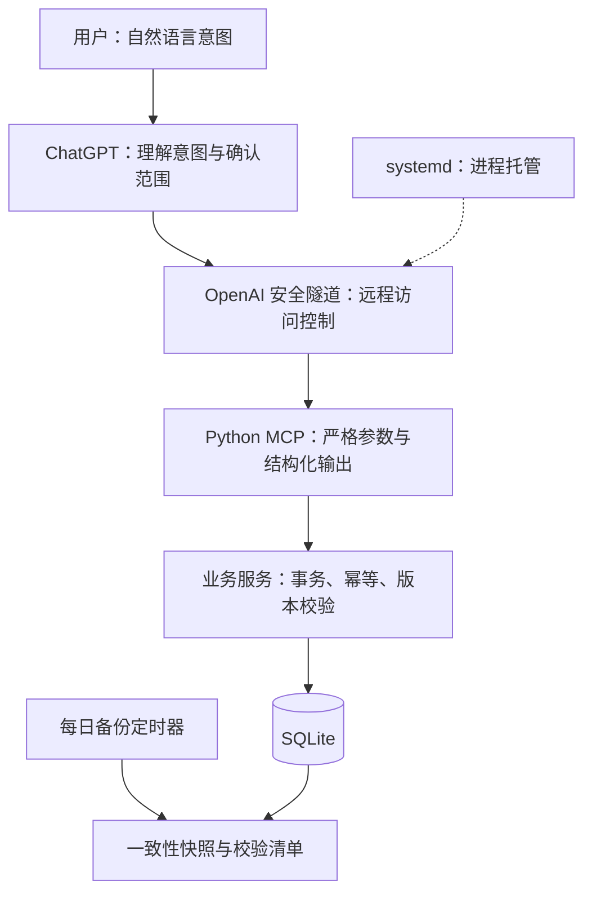

# AI 消费与物品管理助手

**面向大数据运维岗位的 AI 工程实践作品：把自然语言操作接入结构化工具，并完成数据一致性控制、测试、云端部署与备份恢复。**

作者：Hao He

这是个人消费与物品管理场景的单用户自托管项目。用户通过 ChatGPT 表达购买、退货、查询和整理意图，模型调用 MCP 工具，Python 服务校验参数并更新 SQLite。

本项目展示 AI 工具集成与服务运维能力。目前没有接入 Hadoop、Spark、Flink 或生产监控平台，也没有宣称已提升企业运维效率。

## 已完成的工程成果

| 能力 | 实现及证据 |
| --- | --- |
| AI 工具接入 | 25 个 stdio MCP 工具；严格参数模型、结构化结果和工具权限提示 |
| 数据可靠性 | 请求幂等、可靠订单身份去重、乐观版本校验、事务写入、操作撤销 |
| 业务闭环 | 购买、已有物品、库存、部分退货、金额修正、房间、消费准则、消费汇总 |
| 测试 | 130 项自动化测试；含 MCP SDK 客户端与真实子进程调用 |
| 服务部署 | Ubuntu 24.04 / Python 3.12 上通过测试，使用 systemd 托管隧道与 MCP 子进程 |
| 运行维护 | 健康与就绪检查、异常退出重启、开机自启、一致性备份和离线恢复 |

以上测试数量和上线状态来自 2026-11-11 的实际验证。未进行负载测试、整机重启演练或生产 SLA 评估。仓库提供 CI 配置，首次发布前尚无 GitHub Actions 运行结果。

## 三分钟了解



**一次典型流程：**

1. “买了两把演示雨伞，共 60 元”：新增购买记录和两把库存。
2. “退掉其中一把”：在可靠等价单价或明确退款金额的前提下，更新库存和净支出。
3. “撤销刚才退货”：检查记录版本后，恢复对应变更。
4. 同一请求重试：命中幂等记录，避免库存重复增加。

日常购买未提供金额时允许保存未知金额，不主动反复追问。已退货即抵扣消费金额，不增加“退款到账确认”流程。

## 本地快速演示

不需要 ChatGPT 账号、运行密钥或云服务器即可运行本地业务演示。

Windows PowerShell：

```powershell
python -m venv .venv
.\.venv\Scripts\python.exe -m pip install -r requirements.txt
.\.venv\Scripts\python.exe portfolio_demo.py
```

Linux / macOS：

```bash
python3 -m venv .venv
.venv/bin/python -m pip install -r requirements.txt
.venv/bin/python portfolio_demo.py
```

演示只创建临时数据库，包含虚构物品，退出后自动清理。会输出购买、请求重试、金额修正、退货、撤销和备份验证的结果。

## 运行测试

在已安装依赖的 Python 环境中运行：

```bash
python -m unittest test_purchase_corrections test_maintenance test_mcp test_orders test_quantities test_return_corrections test_rules test_rooms test_owned test_service verify_local
```

启动独立 stdio MCP 服务：

```bash
python mcp_server.py --db data/demo.sqlite3
```

该命令等待 MCP 客户端通过标准输入输出通信，不会打开网页。远程接入需另外配置安全隧道及对应访问权限。

## 设计取舍

- **AI 负责理解，工具负责事实写入**：工具不执行任意 SQL 或任意文件操作；模型不能通过额外参数覆盖数据库路径。
- **单用户 + SQLite**：降低部署和维护成本，适合个人低并发场景；尚不适合直接作为多用户高并发服务。
- **未知值保留未知**：未提供金额不填成 0，消费统计保留不完整性提示。
- **撤销检查版本**：已有后续修改时保守拒绝，避免撤销覆盖更新的数据。
- **备份先验证再恢复**：SHA256、数据库完整性、结构兼容性检查与维护锁共同限制错误恢复。

## 阅读路线

- [可靠性设计与测试证据](docs/reliability.md)
- [Linux 部署与维护](docs/deployment.md)
- [演示视频脚本](docs/demo-script.md)
- [简历与面试讲解](docs/career.md)
- [公开发布检查与项目边界](docs/publication.md)

## 主要代码

| 文件 | 职责 |
| --- | --- |
| `mcp_server.py` | MCP 工具、参数校验、预览确认与结构化错误 |
| `service.py` / `orders.py` | 业务事务、购买、退货、订单去重与撤销 |
| `rooms.py` / `quantities.py` / `rules.py` | 房间与批量操作、数量纠错、消费准则 |
| `database.py` / `schema.sql` | 初始化、约束和结构校验 |
| `maintenance.py` / `file_lock.py` | 一致性备份、离线恢复与跨平台锁 |
| `portfolio_demo.py` | 可复现的虚构数据演示 |
| `test_*.py` | 隔离数据库的业务及协议测试 |

## AI 协作说明

项目通过人与 AI 编程工具协作完成。求职者应准确说明自己承担的需求判断、方案取舍、验证和运维工作，并能解释关键代码；不将 AI 生成代码表述为全部独立手写，也不把该个人项目表述为企业生产经历。

展示版不包含正式数据库、个人备份、运行密钥、私人截图或实际隧道配置。当前未选择开源许可证；公开展示与授予第三方使用许可是两件事，发布时应另行确定授权方式。
