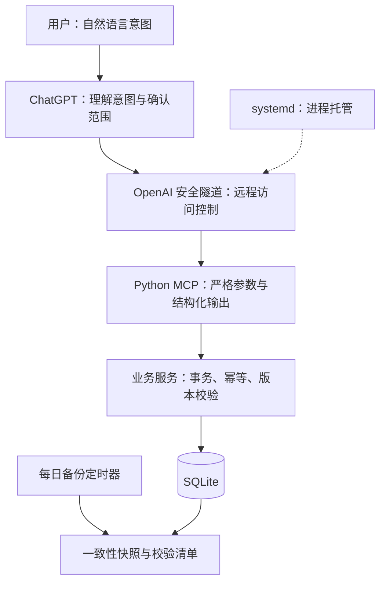

# AI 个人生活助手

**AI 工程实践作品：把自然语言操作接入结构化工具，并完成数据一致性控制、测试、云端部署与备份恢复。**


这是覆盖消费与物品管理、行为准则和日常阶段安排的单用户自托管项目。用户通过 ChatGPT 表达意图，模型调用 MCP 工具，Python 服务校验参数并更新 SQLite。

例如用户说“我在家，无聊想看手机”，助手先确认处于哪个阶段，再根据用户预先制定的安排提醒；不会仅凭钟点推断已经完成某一步。

本项目展示 AI 工具集成与服务运维能力。

## 已完成的工程成果

| 能力 | 实现及证据 |
| --- | --- |
| AI 工具接入 | 36 个 stdio MCP 工具；严格参数模型、结构化结果和工具权限提示 |
| 数据可靠性 | 请求幂等、可靠订单身份去重、乐观版本校验、事务写入、操作撤销 |
| 业务闭环 | 购买、已有物品、库存、部分退货、金额修正、房间、消费准则、消费汇总 |
| 测试 | 164 项业务／协议测试 + 11 项独立结构场景检查；含真实 MCP 子进程 |
| 行为提醒 | 流程与适用星期、阶段优先、三值匹配、缺阶段先询问、启停与对话维护 |
| 批量与迁移 | 内存预览、原子执行／撤销、过期与状态变化检查，结构版本 1→2 的显式备份迁移 |
| 服务部署 | Ubuntu 24.04 / Python 3.12 上通过测试，使用 systemd 托管隧道与 MCP 子进程 |
| 运行维护 | 健康与就绪检查、异常退出重启、开机自启、一致性备份和离线恢复 |

正式功能于 2026-11-13 在 Ubuntu 24.04 / Python 3.12 完成回归、迁移、连接刷新和代表性只读对话验收。展示版使用独立虚构数据，具体本地验证与 CI 状态见 [验证记录](docs/verification.md)。未进行负载测试、整机重启演练或生产 SLA 评估。

## 三分钟了解



**一次典型流程：**

1. “买了两把演示雨伞，共 60 元”：新增购买记录和两把库存。
2. “退掉其中一把”：根据已知购买金额与数量同步调整库存和净支出。普通清理建议本身不扣减库存或金额。
3. 同一请求重试：命中幂等记录，避免库存重复增加。

日常购买未提供金额时允许保存未知金额，不主动反复追问。

## 本地快速演示

不需要 ChatGPT 账号、运行密钥或云服务器即可运行本地业务演示。

Windows PowerShell：

```powershell
python -m venv .venv
.\.venv\Scripts\python.exe -m pip install -r requirements.txt
.\.venv\Scripts\python.exe portfolio_demo.py
```

Linux / macOS：

```bash
python3 -m venv .venv
.venv/bin/python -m pip install -r requirements.txt
.venv/bin/python portfolio_demo.py
```

演示只创建临时数据库，包含虚构物品，退出后自动清理。会输出购买、请求重试、金额修正、退货、撤销、虚构阶段流程的批量导入、阶段确认、星期调整和备份验证结果。所有演示安排均为专门构造的样例。

## 运行测试

在已安装依赖的 Python 环境中运行：

```bash
python -m unittest discover -q
python verify_local.py
```

启动独立 stdio MCP 服务：

```bash
python mcp_server.py --db data/demo.sqlite3
```

该命令等待 MCP 客户端通过标准输入输出通信，不会打开网页。远程接入需另外配置安全隧道及对应访问权限。

## 设计取舍

- **AI 负责理解，工具负责事实写入**：工具不执行任意 SQL 或任意文件操作；模型不能通过额外参数覆盖数据库路径。
- **单用户 + SQLite**：降低部署和维护成本，适合个人低并发场景；尚不适合直接作为多用户高并发服务。
- **未知值保留未知**：未提供金额不填成 0，消费统计保留不完整性提示。
- **撤销检查版本**：已有后续修改时保守拒绝，避免撤销覆盖更新的数据。
- **备份先验证再恢复**：SHA256、数据库完整性、结构兼容性检查与维护锁共同限制错误恢复。

## 阅读路线

- [行为准则与阶段提醒](docs/behavior-rules.md)
- [可靠性设计与测试证据](docs/reliability.md)
- [Linux 部署与维护](docs/deployment.md)
- [演示视频脚本](docs/demo-script.md)
- [公开发布检查与项目边界](docs/publication.md)

## 主要代码

| 文件 | 职责 |
| --- | --- |
| `mcp_server.py` | MCP 工具、参数校验、预览确认与结构化错误 |
| `service.py` / `orders.py` | 业务事务、购买、退货、订单去重与撤销 |
| `rooms.py` / `quantities.py` / `rules.py` | 房间与批量操作、数量纠错、消费准则 |
| `database.py` / `schema.sql` / `migrations/` | 显式结构迁移、约束及历史校验 |
| `behaviors.py` / `behavior_matching.py` | 流程维护、三值匹配与阶段确认保护 |
| `behavior_plans.py` / `behavior_protocol.py` | 封闭计划动作、批量事务与严格嵌套输入 |
| `query_paging.py` | 签名分页游标、筛选绑定和结果变更检测 |
| `maintenance.py` / `file_lock.py` | 一致性备份、离线恢复与跨平台锁 |
| `portfolio_demo.py` | 可复现的虚构数据演示 |
| `test_*.py` | 隔离数据库的业务及协议测试 |


当前阶段、已完成事项和当日例外仅保留在本次聊天；长期适用星期通过流程配置维护。普通自然语言同义关系仍需模型结合原文理解，三值匹配不会把未知信息当作否定。公开版本不含个人作息、正式数据库或实际服务器配置。
